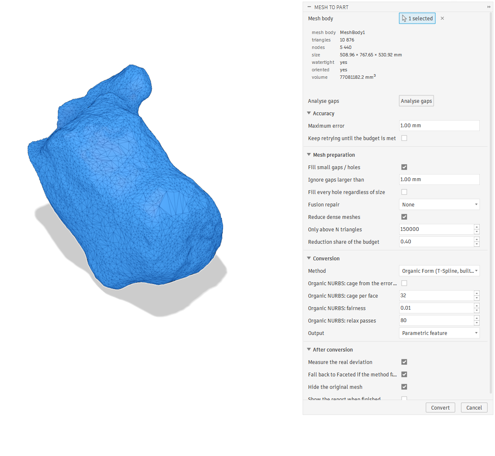
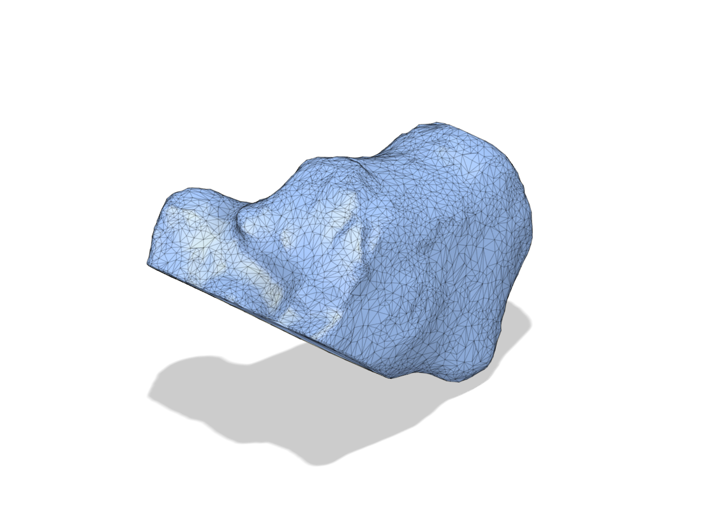
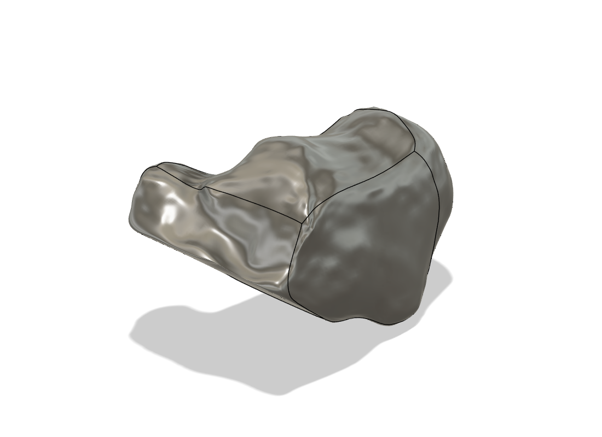

# Mesh to Part

A Fusion 360 add-in that turns an imported mesh (STL) into a **solid or a Form
body** under an explicit **maximum-error budget**, and then *measures* the real
deviation of the result against the original mesh instead of assuming it.

It includes a from-scratch organic mesh-to-Form conversion that does **not**
require the Product Design Extension.



| input mesh | Form body |
|---|---|
|  |  |

*A 10 876-triangle calcaneus scan, and the six-patch T-Spline Form body built from
it: watertight, volume within 0.23%, editable in the Form environment.*

## How to use

The add-in has two commands: **Mesh to Part** (mesh to solid or Form body) and
**Wrap (offset)** (grow or shrink a body by a distance). Both are described below.

### Where the buttons are

In the **Design** workspace:

| Button | Tab and panel |
|---|---|
| **Mesh to Part** | **Mesh** tab, **Modify** panel, and **Solid** tab, **Create** panel |
| **Wrap (offset)** | **Mesh** tab, **Modify** panel, and **Solid** tab, **Modify** panel |

Both buttons are promoted, so they show on the toolbar, not only in the panel's
drop-down. If one of these panels does not exist in your Fusion build, the add-in
uses the next panel on its short list (for example **Mesh > Prepare**).

### Before you start

- **A mesh body in the design**, for example a segmentation imported as STL
  (**Insert > Insert Mesh**). If the design holds exactly one mesh body, Mesh to
  Part selects it for you.
- **For a Form (T-Spline) result, a parametric design.** The two Form methods
  refuse to run with design history off. Turn it on (right-click the document name
  in the browser, **Capture Design History**) or use **Organic NURBS**, which works
  in a direct design.
- **An external Python for some methods.** Fusion's own Python has no numpy, so
  part of the work runs in a separate Python 3 install:

  | Needs the external Python | Works without it |
  |---|---|
  | **Organic Form (quad remesh)** | Cylinder / cone / box (analytic, any licence) |
  | Smooth creases, Wrap offset (inside Mesh to Part) | Prismatic (planes, cylinders, cones) |
  | the **Wrap (offset)** command | Organic (Form / T-Spline), Fusion's own, needs the extension |
  | | Faceted (one face per triangle) |

  Install the packages into that Python:

  ```
  pip install numpy scipy trimesh pyvista open3d PyNanoInstantMeshes
  ```

  `open3d` and `PyNanoInstantMeshes` are what **Organic Form (quad remesh)** needs;
  without them it is not listed.

  `numpy`, `scipy` and `trimesh` are what the add-in checks for when it looks for
  an interpreter. `pyvista` is not checked, but Wrap, Smooth creases and the
  quad cage's *From the scan* source import it and fail without it. Two packages
  are optional: `PyNanoInstantMeshes` (the *Instant Meshes* cage source) and
  `gmsh` (the *gmsh remesh* cage source).

  The add-in looks for the interpreter in this order and takes the first one that
  can import numpy, scipy and trimesh:

  1. the `MESHTOPART_PYTHON` environment variable (full path to `python.exe`);
  2. a file `python_path.txt` beside the installed add-in
     (`%APPDATA%\Autodesk\Autodesk Fusion 360\API\AddIns\MeshToPart\python_path.txt`)
     holding that full path on one line;
  3. `%LOCALAPPDATA%\Programs\Python\Python312\python.exe`, then `Python311`,
     then `Python310`;
  4. `C:\Python312\python.exe`, `C:\Python311\python.exe`, `C:\Python310\python.exe`;
  5. `/usr/bin/python3`, `/usr/local/bin/python3`;
  6. the `py` launcher: `py -3.12`, `py -3.11`, `py -3.10`, `py -3`.

  If none works, the three built-in organic methods are simply missing from the
  **Method** list.

### Organic Form (quad remesh): the organic method

For a bone or any other organic scan, pick **Organic Form (quad remesh)** (Auto picks
it). It is the one organic method in the list; the earlier cube-sphere and quad-cage
methods were retired from the dialog.

1. Select the mesh (or a solid, to rebuild or offset it).
2. **Maximum error**: the p99 deviation you accept, both directions. 0.1 mm is a good
   value for a bone that a guide will sit on.
3. **Element size (0 = auto)**: leave 0. Auto gives about 8000 quads over the surface
   (3 mm on a 500 mm femur) and goes finer, within a minute, if the p99 is over the
   maximum error.
4. **Offset (0 = none)**: builds the body that far outside the mesh along its normal
   (negative: inside), e.g. 0.2 mm for a clearance body. No Wrap needed for this.
5. Convert. The progress dialog has a working **Cancel**: it stops the engine at
   once and leaves nothing in the design.

What happens: Instant Meshes lays a field-aligned quad cage over the mesh (about 2 %
of its vertices extraordinary), and the cage is solved so its Catmull-Clark limit
surface - the surface Fusion builds from it - lies on the mesh, by point-to-plane
least squares in both directions. The cage goes to Fusion as one Form feature.
Fusion's own tessellation of that body is then measured against the mesh, and that
is what the report gives.

Measured on a 500 mm artificial femur, live in Fusion:

| input | time | B-Rep faces | p99 / rms both ways | volume |
|---|---|---|---|---|
| 173 286 triangles (1 mm mesh) | 20 s | 465 | 0.060 / 0.016 mm | +0.010 % |
| 6 544 triangles | 20 s | 433 | 0.098 / 0.030 mm | +0.005 % |
| 173 286 triangles, offset +0.2 mm | 30 s | 465 | offset achieved 0.200 mean, 0.14 - 0.22 mm | |

The time depends on the cage, not on the triangles. The worst single point (0.58 and
0.88 mm here) is one sharp spike at the femoral head, which a smooth surface does not
follow; the report gives its position. The old quad-cage method made 20 178 B-Rep faces
from the same femur in 3 to 6 minutes, and its retry ladder could not be cancelled.

### Mesh to Part, step by step

1. Click **Mesh to Part**. The dialog opens with the OK button labelled **Convert**.
2. In **Body**, select one or more mesh bodies. Each one is converted in turn with
   the same settings. The selection also accepts a solid, but this command converts
   mesh bodies only (use **Wrap (offset)** for a solid).
3. Read the **Mesh** box: name, triangles, nodes, size in mm, watertight, oriented,
   and volume when the mesh is closed.
4. Optional: click **Analyse gaps**. The box then lists the open boundaries and the
   widest gap, and says what gap limit closes them all.
5. Set **Maximum error** (your budget in mm).
6. Optional but recommended: click **Auto: choose settings for this mesh**. It
   measures the first selected mesh and writes settings into the dialog. It
   converts nothing. The box explains every choice it made. Change anything you
   disagree with.
7. Check or change the inputs below, then click **Convert**.

The settings you used are saved (`last_settings.json` beside the installed
add-in) and come back next time. The defaults below are the first-run values.
Many inputs only show for the method that uses them.

**Accuracy**

| Input | Default | What it does |
|---|---|---|
| Maximum error | 0.1 mm | The budget. The result is measured against the original mesh and compared to it. Must be above 0. |
| Keep retrying until the budget is met | on | If the first result is over budget, try again with finer settings (the "ladder"). |
| Max attempts | 3 (1 to 4) | How many rungs of the ladder to try. Shown when retrying is on. |

**Mesh preparation** (done on a working copy; the original mesh is not edited)

| Input | Default | What it does |
|---|---|---|
| Fill small gaps / holes | on | Closes open boundaries before conversion. |
| Ignore gaps larger than | 1.0 mm | Holes wider than this are left open. Hidden when the next box is ticked. |
| Fill every hole regardless of size | off | Closes all holes. |
| Fusion repair | None | Optional Fusion mesh repair: None, Stitch and remove artifacts, Close holes, One-touch fix, Wrap, Rebuild. |
| Rebuild density | 128 (8 to 256) | Shown for **Rebuild** only. |
| Reduce dense meshes | on | Reduces the triangle count with Fusion's adaptive reduce, at a maximum deviation taken from the budget. |
| Only above N triangles | 150 000 | Reduce only meshes larger than this. |
| Reduction share of the budget | 0.4 (0.05 to 0.9) | Fraction of **Maximum error** the reduction may use. 0.4 with a 0.1 mm budget allows 0.04 mm. |

**Conversion**

| Input | Default | Shown for | What it does |
|---|---|---|---|
| Method | Prismatic, or the first available | all | The conversion. Only methods your licence and Python allow are listed. See the table below. |
| Organic resolution | Auto from max error | Organic (Fusion's) | Low, Medium, High, Precise, or By face count. |
| Face count | 5000 | Organic, By face count | Target face count. |
| Faceted: cap faces at | 20 000 | Faceted | A larger mesh is reduced to this many triangles first, because Faceted makes one face per triangle. |
| Organic: cage from the error budget | on | Form (T-Spline), NURBS | Picks the cage size from the budget and the mesh size. |
| Organic: cage per face | 24 (8 to 72) | Form, NURBS, when the box above is off | Cage size per cube face. |
| Organic: control net / cage (NURBS only) | 0.5 | Form, NURBS | Ratio of control points to cage points. Below 1 the patch is a smoothing fit, not an interpolation. |
| Quad cage: cage from | Instant Meshes | quad cage | *Instant Meshes* (cleanest quads, needs PyNanoInstantMeshes), *From the scan* (robust, any element size), *gmsh remesh* (needs gmsh). Instant Meshes falls back to the scan cage if the package is missing. |
| Quad cage: target element size | 2.0 mm | quad cage | Edge length of the cage quads. Smaller is more accurate and slower. |
| Quad cage: elements per curvature circle | 16 (0 to 60) | quad cage with gmsh | gmsh's curvature refinement. |
| Organic: max edge ratio in an element (0 = off) | 1.2 | Form, NURBS, quad cage | Limit on longest/shortest edge within one element. |
| Organic: edge-ratio passes | 80 | Form, NURBS | Passes spent on that limit. |
| Organic: edge equalising passes (0 = off) | 120 | Form, NURBS | Passes that even out edge lengths. |
| Organic: min element edge (0 = off) | 1.5 mm | Form, NURBS, quad cage with gmsh | Smallest element edge allowed. |
| Smooth creases: passes (0 = off) | 0 | always | Volume-preserving smoothing of the working mesh before conversion. Not used by Cylinder / cone / box. |
| Wrap: offset distance (0 = off) | 0 mm | always | Offsets the working mesh before conversion (same engine as the Wrap command). Not used by Cylinder / cone / box. |
| Wrap: close gaps up to | 0 mm | always | Gap closing for that offset. |
| Organic: fairness (NURBS only) | 0.01 | Form, NURBS | Smoothing weight of the NURBS fit. |
| Organic: relax passes | 70 | Form, NURBS | Passes that slide the cage along the surface into concavities. |
| Smooth remaining open hole boundaries | on | Organic (Fusion's) | Fusion's hole preprocessing. |
| Generate face groups (prismatic) | on | Prismatic | Groups triangles into faces before conversion. |
| Feature angle | 25 deg | Prismatic, face groups on | Angle that separates face groups. |
| Smallest face group (area fraction) | 0.02 | Prismatic, face groups on | Smaller groups are merged. |
| Output | Parametric feature | all | *Parametric feature* or *Base feature (direct)*. Applies to Fusion's own methods (Prismatic, Organic, Faceted). |

**After conversion**

| Input | Default | What it does |
|---|---|---|
| Measure the real deviation | on | Measures the result against the original mesh, both ways. Off means no check, and the first result is kept. |
| Fall back to Faceted if the method fails | on | If the method gives no usable body, or is not allowed by the licence, use Faceted instead. The report says so. |
| Hide the original mesh | on | Hides the source mesh body after conversion. |
| Show the report when finished | on | Shows the report in a message box. It is saved to a file either way. |

**Which method to pick**

| Method (label in the list) | Result | Use it for |
|---|---|---|
| Cylinder / cone / box (analytic, any licence) | an exact cylinder, cone (3 faces) or box (6 faces) | a tessellated pin, screw axis, drill sleeve, cut block or plate. Refused if the mesh is not one of these shapes. |
| **Organic Form (quad remesh)** | a Form body of a few hundred B-Rep faces, measured against the mesh | bones and every other organic scan; what Auto picks for organic meshes. Parametric design only. |
| Prismatic (planes, cylinders, cones) | analytic faces | machined CAD meshes. Not available on Fusion Personal. |
| Organic (Form / T-Spline) | Fusion's own T-Spline conversion | only with the Product Design Extension. |
| Faceted (one face per triangle) | exact, one face per triangle | when nothing else works. Heavy on large meshes. |

### What you get

All output goes into the same component as the source mesh.

- The converted body, named **`<mesh name> [part]`**.
- For **Cylinder / cone / box** in a parametric design: a base feature named
  `<mesh name> [cylinder fit]`, `[cone fit]` or `[box fit]` holding that body.
- For the Form methods: a Form feature you can edit in the Form environment.
- For Fusion's own methods: the mesh features in the timeline (repair, reduce,
  face groups, convert), applied to a working copy.
- A working copy named `<mesh name> [work HHMMSS]` (and `[work smooth ...]` or
  `[work wrap ...]` when those options are on). The original mesh is never
  edited. If a working copy is left over after the conversion it is hidden;
  delete it once you are happy with the result.
- The original mesh is hidden when **Hide the original mesh** is on.
- A report, shown in a message box and saved as
  `reports\report_YYYYMMDD_HHMMSS.txt` beside the installed add-in. Errors and
  tracebacks go to `MeshToPart.log` in the same folder.

### Checking the result

The report has four parts: **INPUT**, **PREPARATION**, **CONVERSION** and
**MEASURED DEVIATION**. Before you use the part:

1. Read **MEASURED DEVIATION**. It gives max, p99, p95 and RMS in mm in two
   directions: `part -> mesh` (how far the new surface is from the mesh) and
   `mesh -> part` (how far the mesh is from the new surface, which catches
   geometry the conversion dropped). The line **worst of both directions** is the
   number compared with your budget.
2. Read the **RESULT** line: *within the budget* or *OVER the budget by ... mm*.
   Over budget means the part was kept anyway; the report says what to change.
3. Check **solid**: it should be `True` for a closed scan. If the source was closed
   and the result is not a solid, a **WARNING** line says geometry was dropped.
4. Check **method**: if it says *fell back from ...*, you got Faceted, not the
   method you chose. **ladder** and **used** show which attempt was kept.
5. Read **NOTES** for failed repair, reduction, smoothing or offset steps.
6. For a cylinder or cone, check the fitted diameter, length and axis. The report
   also says how far the mesh flats sit inside the fitted circle.
7. If the max is much larger than p95, the error sits at a few isolated spots
   (often sharp creases in the scan). Look at those spots in Fusion before
   deciding whether they matter.

With **Measure the real deviation** off there are no deviation figures at all.
The measurements check the conversion; they do not validate the device design.

### Wrap (offset), step by step

1. Click **Wrap (offset)**. The OK button is labelled **Wrap**.
2. In **Body**, select one mesh body or one solid.
3. Set the inputs below and click **Wrap**.

| Input | Default | What it does |
|---|---|---|
| Offset distance | 4.0 mm | Grows the body by this distance; a negative value shrinks it. Cannot be 0. |
| Close gaps up to | 0 mm | Closes gaps up to this size before the offset (0 = off). |
| Smooth creases: passes | 0 (0 to 200) | Smoothing passes on the offset surface. |
| Create | Offset mesh body only | *Offset mesh body only*, *Solid: quad cage Form (size-driven)*, or *Solid: organic NURBS*. |
| Solid: target element size | 8.0 mm | Shown for the quad cage Form. Cage element size. |
| Solid: min element edge | 1.5 mm | Shown for the quad cage Form. Only used by a gmsh cage, which Wrap does not select, so it has no effect in practice. |
| Solid: elements per curvature circle | 16 | Shown for the quad cage Form. Same note as above. |
| Hide the original | on | Hides the selected body afterwards. |

Wrap settings are saved separately (`last_settings.json.wrap`).

**What you get:** a mesh body named `<body name> [wrap +4.00]` (the signed offset
in mm) in the same component. With a **Solid** option, that mesh is then run
through Mesh to Part with fixed settings (budget 1.0 mm, 3 attempts, no
reduction, deviation measured) and the solid is named
`<body name> [wrap +4.00] [part]`; the offset mesh is then hidden. The quad cage
Form needs a parametric design.

**Checking the result:** Wrap does **not** open a report window. It writes the
report to `reports\report_YYYYMMDD_HHMMSS.txt` beside the installed add-in and one
summary line to Fusion's Text Commands window. The report gives the requested
offset, the **achieved** offset (mean, min, max in mm, measured from the new
surface back to the source), the RMS spread, the voxel pitch, and whether the
offset mesh is watertight. Check min and max against what you asked for. With a
Solid option, the Mesh to Part report follows; its deviation is measured against
the offset mesh, not the body you selected.

### Where it fits in a patient-specific workflow

A segmentation exported as STL is a mesh; Fusion can only cut, combine and shell
solids. Mesh to Part turns the bone mesh into a solid (or Form body) you can
subtract from a guide blank, and turns tessellated pins or screw axes into exact
cylinders for trajectories. Wrap gives an offset shell around the anatomy, for
example a clearance gap between a guide and the bone. A typical order is:
segmentation STL, then Global Registration, then Mesh to Part, then guide or plate
design, then Batch STL Export.

### Known limits

- The two Form methods need a **parametric** design. In a direct design they stop
  with a message; use Organic NURBS.
- **Prismatic** is not available on Fusion Personal; **Organic** (Fusion's own)
  needs the Product Design Extension. Methods the licence does not allow are not
  listed.
- **Auto** looks at the first selected mesh only. It tries the analytic
  cylinder / cone / box fit only on meshes up to 20 000 triangles.
- **Organic Form (quad remesh)** needs a closed mesh (small holes are filled) and a
  parametric design. Its time limit is a minute for the fit; a p99 budget it cannot
  reach in that time is reported as OVER, with the best body built.
- The mesh-convert API is marked *preview* by Autodesk; Fusion updates can change it.
- A finer cube-sphere cage is more likely to self-intersect, which Fusion refuses.
  The Form ladder steps **down** until a cage is accepted, so the report may name
  a coarser cage than you asked for.
- The quad cage's elements are accurate but not tidy. If you will sculpt the
  result by hand, try the gmsh source; the report says if it lost anything.

## Why

Fusion's own **Convert Mesh → Organic** needs the Product Design Extension. Without
it you get `Prismatic`, which refuses organic anatomy outright, and `Faceted`,
which is exact but gives one BRep face per triangle. Neither is workable for a scan.

This add-in adds two methods of its own that need no extension:

| Method | Output | Needs extension |
|---|---|---|
| **Organic Form (T-Spline)** | a real **Form body**, 6 patches, editable with Fusion's sculpt tools | no |
| **Organic NURBS** | a 6-patch NURBS solid, watertight by construction | no |
| **Organic Form (quad cage)** | a Form body whose cage is a size-driven quad mesh, not a stretched cube | no |
| **Cylinder / cone / box** | an exact analytic cylinder or cone (3 faces) or rectangular box (6 faces) fitted to the mesh | no licence at all |
| Prismatic | Fusion's own — planes, cylinders, cones | not on **Fusion Personal** |
| Faceted | Fusion's own — one face per triangle, exact | no |
| Organic | Fusion's own T-Spline conversion | **yes** |

**Cylinder / cone** exists because Fusion Personal refuses Prismatic ("No rights for
mesh conversion"), so a tessellated pin or screw axis fell through to the organic quad
cage. It fits the axis from the two end caps (or, without caps, from the side normals),
the axis line by a circle fit, and the radius as a linear function along it, then builds
the solid with `TemporaryBRepManager.createCylinderOrCone`. Every vertex has to lie on the
side or on a cap within max(budget / 10, 0.5 % of the radius), and fewer than 8 facets
per turn is a prism, not a cylinder. The cylinder goes through the mesh vertices; the
report says how far the flats sit inside it. Auto picks it whenever a mesh fits. On
a distal radius case, twelve pins and screw axes came out Ø 2.0 / 2.4 / 2.5 mm, each within 0.02 mm of
its mesh, in under a second each.

A **box** - a cut profile, a plate, a block, in any orientation - is tried first, because
its test is the strict one: the three axes come from the face normals (the largest planar
direction, the largest one square to it, their cross product), the extents from the
vertices' spans, and then every triangle must lie on one of the six faces within budget / 10
and each face must be covered to 0.5 % of its rectangle, so a notch, a hole, a chamfer or a
missing face is refused. It is built with `TemporaryBRepManager.createBox`. A 30 x 20 x 0.8
mm saw-cut profile (12 triangles, 1 m from the origin) came out a 6-face solid within
0.0001 mm and 0.01 % of the mesh volume, in 0.8 s. A thin plate is why the box goes first:
its four corners also lie on a circle.

Whatever the method, the budget is enforced the same way: convert, measure the
deviation **both ways** against the source mesh, and climb an escalation ladder
until it fits or the ladder runs out. The report says which happened.

## Measured accuracy

Every figure below was measured inside Fusion against the source mesh.

| input | method | max | RMS | p95 | volume error | faces |
|---|---|---|---|---|---|---|
| sphere ⌀30 mm | Form | 0.039 mm | 0.012 mm | 0.024 mm | +0.04% | 6 |
| sphere ⌀30 mm (engine) | NURBS | 0.012 mm | 0.004 mm | — | −0.02% | 6 |
| capsule (engine) | NURBS | 0.121 mm | 0.021 mm | — | −0.01% | 6 |
| calcaneus scan, 1063 mm diagonal | Form | 12.7 mm | 1.14 mm | 1.92 mm | −0.23% | 6 |
| calcaneus scan | NURBS | 12.9 mm | 0.87 mm | 1.28 mm | −0.13% | 6 |
| distal radius scan, 185 mm diagonal | quad cage, 2 mm | 0.16 mm | 0.020 mm | 0.043 mm | −0.10% | 3702 |

A cage of radius 2.0 emitted as TSM produced a body **32.9146 mm** across; the
Catmull-Clark limit maths predicts **32.9146 mm**. A fitted 30 mm sphere came back
as **29.9986 mm**.

On the calcaneus, judge by p95/RMS. The max sits at a handful of isolated 150°
creases in a mesh whose mean edge length is 15.7 mm — no smooth surface reproduces
those, and Fusion's own Organic conversion would round them too.

## Auto

A button at the top of the dialog: **Auto: choose settings for this mesh**. It
measures the mesh and writes the settings into the dialog — it converts nothing,
so everything it picks is there to be overridden before you press OK.

What it measures, and what each measurement decides:

- **Open boundaries and their spans** → gap filling on or off, and the limit set
  just above the widest gap.
- **Normal consistency** → stitch-and-remove-artifacts, or no repair.
- **The dihedral angle across every shared edge** → machined or organic. What
  separates them is not flatness alone (a cube is only a third coplanar, because
  its other edges are 90° creases) but that every edge is *either* flat *or* a
  crisp crease: 100% decided for a cube against 19% for a distal radius scan.
  Machined goes to Prismatic, organic to the quad cage.
- **The candidate cages themselves** → the element size. The cage is the cheap
  half of the pipeline — about 0.2 s against 8–27 s for the fit — so Auto builds
  six or seven of them across the useful range and measures each against the
  scan, rather than inverting a formula. It then takes the *coarsest* whose own
  worst deviation is already inside the budget.

Measured on a distal radius over 8.0 down to 1.2 mm, the final worst-of-both-
directions deviation came out at 0.44–0.53 × the cage's own worst, so the cage
figure is used directly and roughly a factor of two is left in hand. That margin
is deserved: the **rms** falls as a clean power law in element size
(`0.0070 h^1.56` mm on that scan) but the **worst single point** does not fall
monotonically at all — it is set by isolated spots on the scan, not by the cage.
So Auto also turns escalation on, and the ladder measures its way down if the
prediction was optimistic.

The ladder stops where the cage would exceed about 16 000 quads, because that is
cost rather than accuracy running out. When the budget is unreachable within that
cap, Auto says so instead of pretending.

## Wrap (offset)

A second command, in **Mesh -> Modify** and **Solid -> Modify**. It grows or
shrinks a body by a distance.

Offset Face and Shell work face by face, and they give up on organic geometry
because an outward offset self-intersects wherever the concave radius is smaller
than the offset -- between toes, behind a malleolus. A level set has no such
case: the isosurface at distance *d* IS the offset, and the material merging in a
concavity is automatic rather than a failure. So the body is rasterised to a
signed distance field, the isolevel is shifted, and the surface re-extracted.

The distance transform alone is not accurate enough -- it measures to voxel
centres and counts a partly covered voxel as solid, biasing the result outward by
about 0.4 x the voxel pitch. Exact point-to-surface distance is computed in a
narrow band around the isolevel, which is a thin shell and therefore cheap.
Measured on a 20 mm sphere: **+4.0 mm asked, 3.9987 mm achieved**; -3.0 mm asked,
-3.0019 mm achieved. On a 75k-triangle skin scan, +4.0 mm gives mean 3.9989, min
3.9492, max 4.1288, rms 0.0087 mm, in 8.9 s.

It reports the offset it actually achieved rather than assuming it hit the
number. Output is a mesh body, or straight through to a solid.

## Install

1. Clone or copy this folder anywhere.
2. Run `powershell -File install.ps1`. It copies the add-in into
   `%APPDATA%\Autodesk\Autodesk Fusion 360\API\AddIns\MeshToPart`.
3. In Fusion: **Utilities → ADD-INS → Scripts and Add-Ins → Add-Ins** →
   `Mesh to Part` → tick **Run on Startup** → **Run**.
4. The button appears in **Mesh → Modify** and **Solid → Create**, and
   **Wrap (offset)** in **Mesh → Modify** and **Solid → Modify**.

### The one external requirement

The organic fitting runs in a Python with **numpy, scipy and trimesh**, because
Fusion's bundled interpreter has none of them:

```
pip install numpy scipy trimesh pyvista
```

`pyvista` is needed by the Wrap tool (VTK marching cubes and exact
point-to-surface distance) and by the **quad cage** method's scan cage. The quad
cage's *Instant Meshes* source needs `pip install PyNanoInstantMeshes` and its
*gmsh* source needs `pip install gmsh`; without them the method still works, from
the scan cage.

The add-in finds an interpreter automatically — the `MESHTOPART_PYTHON`
environment variable, a `python_path.txt` beside the add-in, the usual install
locations, then the `py` launcher. If none is found, the three built-in organic
methods are simply absent from the method list. Cylinder / cone / box, Prismatic
and Faceted work without it.

## How the organic conversion works

A cube-sphere quad cage is shrink-wrapped onto the mesh, then relaxed
*tangentially* so points slide along the surface into concavities instead of being
lifted out of them. From there the two methods diverge:

- **Form** — the cage is solved so its Catmull-Clark *limit* surface lands on the
  mesh, then serialised as TSM and handed to `addByTSMDescription`.
- **NURBS** — each cube face becomes one bicubic patch fitted by constrained least
  squares; every shared cube edge is fitted **once** from the row of cage points
  both patches share, so the body is watertight by construction rather than by
  tolerance. `BRepBodyDefinition` assembles 8 vertices, 12 edges and 6 faces.

### The quad cage, and where its cage comes from

The **quad cage** method does not stretch a cube onto the scan at all. It builds a
cage at a prescribed element size, so element size is the input and the count
follows — which is what lets it hold an edge-length ratio on anatomy where a fixed
grid cannot. There are three sources, chosen in the dialog:

**Instant Meshes** (the dialog's default). A field-aligned quad remesh (Jakob et al.
2015, via `pip install PyNanoInstantMeshes`): it solves an orientation field and a
position field on the scan and extracts quads that follow them, so the cage is rows
of quads with about 2 % extraordinary vertices, against about 50 % for the scan cage.
The result is the cleanest Form to edit, and it fits about 3x faster. It is *not* the
more accurate cage: its vertices are not scan vertices. The few doublets (valence-2
vertices) it leaves are dissolved, and if the module is missing or the cage comes
back open the scan cage is used instead.

| 499 mm artificial femur, ~6000 quads | max | p99 | rms | extraordinary | fit |
|---|---|---|---|---|---|
| Instant Meshes cage | 1.81 mm | 0.19 mm | 0.049 mm | 2.6 % | 11 s |
| scan cage | 1.23 mm | 0.12 mm | 0.036 mm | ~50 % | 34 s |

**From the scan** (what Auto uses, because Auto chases an error budget). Decimate the scan to the triangle count that lands
the quad edge on the requested size, then quadrangulate: every triangle becomes
three quads through its edge midpoints and its centroid. All three kinds of vertex
lie on the decimated surface, so the cage cannot wander off the scan, and density is
a *count* — exact and monotone. Needs nothing but numpy, scipy, trimesh and pyvista.

**gmsh remesh.** `classifySurfaces` + `createGeometry` + recombination. The elements
are tidier — rows of quads, edge ratio p95 2.7 against the scan cage's 5.7 — but the
cage comes out of a global reparametrisation of the scan, and on a bone that
parametrisation is distorted enough to lose whole features. Measured on a distal
radius: the cage sat 6 mm off the surface, 11.8% short on volume, with the scan up
to 11.3 mm from the cage that was supposed to cover it. Asking for finer elements
made it *worse*, because a finer mesh in a distorted parameter space only resolves
the distortion. So the cage is now checked — mesh→cage, not cage→mesh, because
cage→mesh stays small even when the cage has shrunk past a protrusion — and if it
is more than one element away the tool says so and falls back to the scan cage.

| distal radius, 2 mm element | max | p99 | rms | volume | cage cover p99 |
|---|---|---|---|---|---|
| scan cage | 0.16 mm | 0.066 mm | 0.020 mm | −0.10% | 0.17 mm |
| gmsh cage (8 mm, its best) | 1.14 mm | 0.20 mm | 0.046 mm | −0.29% | 1.16 mm |
| gmsh cage (3 mm) | 12.6 mm | — | 0.103 mm | −10.0% | 9.7 mm |

The trade is element shape: quadrangulating a triangle leaves a valence-3 star at
every centroid, and in an obtuse triangle the centroid sits close to the long edge's
midpoint, which makes a 45:1 quad. Those are collapsed against a floor of a quarter
of the element — a quad that loses a corner becomes a triangle, which both the TSM
writer and the limit operator take — bringing the worst ratio to about 13:1 for
0.03 mm of accuracy. T-Splines take star points in their stride; Fusion built every
cage tried here, up to 6132 quads.

Because a cage may now carry triangles, the Catmull-Clark machinery is general:
`subdivision_matrix` is one CC step for faces of any arity, expressed as a sparse
operator so the cage can be *subdivided* (to measure) and *composed into the limit
operator* (to fit) from a single definition. The closed-form limit mask
`(n²P + 4Σadj + Σdiag) / (n(n+5))` holds only on an all-quad cage — a triangle has
no opposite corner — so a mixed cage takes the quad mask on the once-refined cage
instead. All-quad cages still take the closed form exactly, so the cube-sphere
numbers above are unchanged.

Full write-up, including what went wrong and what each mistake cost:
[docs/ORGANIC.md](docs/ORGANIC.md).

The TSM format is undocumented by Autodesk; what it is and how to write one is in
[docs/TSM-FORMAT.md](docs/TSM-FORMAT.md).

## Repository layout

```
MeshToPart.py     add-in shell: lifecycle, toolbar, events, dev bridge
mtp_core.py       all the working code; re-imported on every command
mtp_organic.py    the fitting engine, runs outside Fusion under numpy/scipy
install.ps1       push into Fusion's AddIns folder
resources/        toolbar icons
docs/             ORGANIC.md, TSM-FORMAT.md, index.html, screenshots
tools/            dev-bridge client and live test suites
tests/            offline tests, no Fusion required
```

`mtp_core.py` **hot-reloads** — it is re-imported on every command, so pushing it
takes effect on the next click; only `MeshToPart.py` needs a Stop/Run. Because of
that reload, nothing may keep state in a module global between events: the dialog's
method choice is resolved from the item label, never a remembered index.

## Tests

```
py -3.10 tests/test_geometry.py     # welding, gap spans, ladders, reporting
py -3.10 tests/test_engine.py       # cage, TSM structure, limit surface, fitting
```

`tests/stub` fakes `adsk`, so both run without Fusion. The engine tests check
against analytic answers — a 30 mm sphere, and the 32.9146 mm figure Fusion itself
produced from a known cage.

## The dev bridge

Fusion has no headless mode and no CLI, so the only way to test an add-in
automatically is from inside a running Fusion. Creating a `devbridge.on` file next
to the add-in starts a folder watcher that runs jobs on Fusion's main thread:

```
py -3.10 tools/mtp.py ping | probe | analyse | purge_work | rebuild_toolbar
py -3.10 tools/mtp.py convert '{"options": {"method_key": "form"}}'
py -3.10 tools/livetest.py      # full suite, everything in scratch documents
```

Off by default. Nothing in normal operation depends on it.

## Known limits

- The mesh-convert API is flagged *preview* by Autodesk; its enums can change.
- A Form body needs a **parametric** design. In a direct-modelling design the tool
  says so and points you at Organic NURBS instead.
- A finer cube-sphere cage follows a scan better but is likelier to
  self-intersect, which Fusion refuses outright. The Form ladder therefore steps
  *down* until a cage is accepted, and the report names the one it used. The quad
  cage does not have this problem: no cage tried on a scan has folded.
- The quad cage's elements are accurate but not tidy. If you intend to sculpt the
  result by hand rather than just have a solid, the gmsh cage is worth trying
  first — the report will tell you if it lost anything.
- Preparation (weld, boundary walk) is pure Python inside Fusion — roughly 0.03 s
  per 10 k triangles. The organic fit is the slow part: cage 20 ≈ 30 s,
  cage 32 ≈ 70 s.

## Licence

MIT — see [LICENSE](LICENSE).
