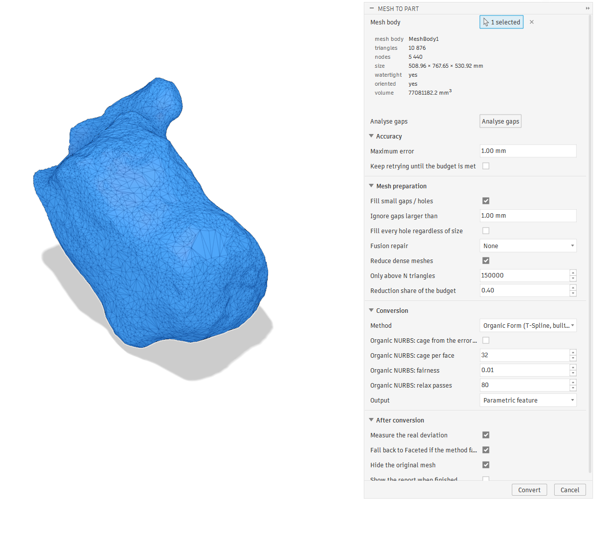
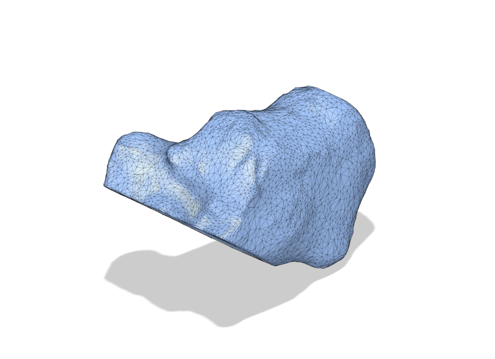
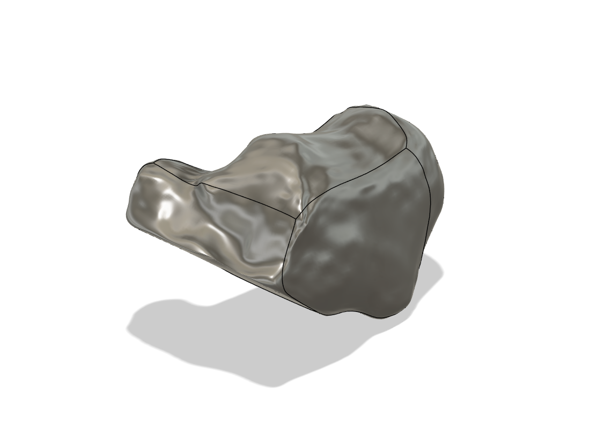

# Mesh to Part

A Fusion 360 add-in that turns an imported mesh (STL) into a **solid or a Form
body** under an explicit **maximum-error budget**, and then *measures* the real
deviation of the result against the original mesh instead of assuming it.

It includes a from-scratch organic mesh-to-Form conversion that does **not**
require the Product Design Extension.



| input mesh | Form body |
|---|---|
|  |  |

*A 10 876-triangle calcaneus scan, and the six-patch T-Spline Form body built from
it: watertight, volume within 0.23%, editable in the Form environment.*

## Why

Fusion's own **Convert Mesh → Organic** needs the Product Design Extension. Without
it you get `Prismatic`, which refuses organic anatomy outright, and `Faceted`,
which is exact but gives one BRep face per triangle. Neither is workable for a scan.

This add-in adds two methods of its own that need no extension:

| Method | Output | Needs extension |
|---|---|---|
| **Organic Form (T-Spline)** | a real **Form body**, 6 patches, editable with Fusion's sculpt tools | no |
| **Organic NURBS** | a 6-patch NURBS solid, watertight by construction | no |
| **Organic Form (quad cage)** | a Form body whose cage is a size-driven quad mesh, not a stretched cube | no |
| Prismatic | Fusion's own — planes, cylinders, cones | no |
| Faceted | Fusion's own — one face per triangle, exact | no |
| Organic | Fusion's own T-Spline conversion | **yes** |

Whatever the method, the budget is enforced the same way: convert, measure the
deviation **both ways** against the source mesh, and climb an escalation ladder
until it fits or the ladder runs out. The report says which happened.

## Measured accuracy

Every figure below was measured inside Fusion against the source mesh.

| input | method | max | RMS | p95 | volume error | faces |
|---|---|---|---|---|---|---|
| sphere ⌀30 mm | Form | 0.039 mm | 0.012 mm | 0.024 mm | +0.04% | 6 |
| sphere ⌀30 mm (engine) | NURBS | 0.012 mm | 0.004 mm | — | −0.02% | 6 |
| capsule (engine) | NURBS | 0.121 mm | 0.021 mm | — | −0.01% | 6 |
| calcaneus scan, 1063 mm diagonal | Form | 12.7 mm | 1.14 mm | 1.92 mm | −0.23% | 6 |
| calcaneus scan | NURBS | 12.9 mm | 0.87 mm | 1.28 mm | −0.13% | 6 |
| distal radius scan, 185 mm diagonal | quad cage, 2 mm | 0.16 mm | 0.020 mm | 0.043 mm | −0.10% | 3702 |

A cage of radius 2.0 emitted as TSM produced a body **32.9146 mm** across; the
Catmull-Clark limit maths predicts **32.9146 mm**. A fitted 30 mm sphere came back
as **29.9986 mm**.

On the calcaneus, judge by p95/RMS. The max sits at a handful of isolated 150°
creases in a mesh whose mean edge length is 15.7 mm — no smooth surface reproduces
those, and Fusion's own Organic conversion would round them too.

## Auto

A button at the top of the dialog: **Auto: choose settings for this mesh**. It
measures the mesh and writes the settings into the dialog — it converts nothing,
so everything it picks is there to be overridden before you press OK.

What it measures, and what each measurement decides:

- **Open boundaries and their spans** → gap filling on or off, and the limit set
  just above the widest gap.
- **Normal consistency** → stitch-and-remove-artifacts, or no repair.
- **The dihedral angle across every shared edge** → machined or organic. What
  separates them is not flatness alone (a cube is only a third coplanar, because
  its other edges are 90° creases) but that every edge is *either* flat *or* a
  crisp crease: 100% decided for a cube against 19% for a distal radius scan.
  Machined goes to Prismatic, organic to the quad cage.
- **The candidate cages themselves** → the element size. The cage is the cheap
  half of the pipeline — about 0.2 s against 8–27 s for the fit — so Auto builds
  six or seven of them across the useful range and measures each against the
  scan, rather than inverting a formula. It then takes the *coarsest* whose own
  worst deviation is already inside the budget.

Measured on a distal radius over 8.0 down to 1.2 mm, the final worst-of-both-
directions deviation came out at 0.44–0.53 × the cage's own worst, so the cage
figure is used directly and roughly a factor of two is left in hand. That margin
is deserved: the **rms** falls as a clean power law in element size
(`0.0070 h^1.56` mm on that scan) but the **worst single point** does not fall
monotonically at all — it is set by isolated spots on the scan, not by the cage.
So Auto also turns escalation on, and the ladder measures its way down if the
prediction was optimistic.

The ladder stops where the cage would exceed about 16 000 quads, because that is
cost rather than accuracy running out. When the budget is unreachable within that
cap, Auto says so instead of pretending.

## Wrap (offset)

A second command, in **Mesh -> Modify** and **Solid -> Modify**. It grows or
shrinks a body by a distance.

Offset Face and Shell work face by face, and they give up on organic geometry
because an outward offset self-intersects wherever the concave radius is smaller
than the offset -- between toes, behind a malleolus. A level set has no such
case: the isosurface at distance *d* IS the offset, and the material merging in a
concavity is automatic rather than a failure. So the body is rasterised to a
signed distance field, the isolevel is shifted, and the surface re-extracted.

The distance transform alone is not accurate enough -- it measures to voxel
centres and counts a partly covered voxel as solid, biasing the result outward by
about 0.4 x the voxel pitch. Exact point-to-surface distance is computed in a
narrow band around the isolevel, which is a thin shell and therefore cheap.
Measured on a 20 mm sphere: **+4.0 mm asked, 3.9987 mm achieved**; -3.0 mm asked,
-3.0019 mm achieved. On a 75k-triangle skin scan, +4.0 mm gives mean 3.9989, min
3.9492, max 4.1288, rms 0.0087 mm, in 8.9 s.

It reports the offset it actually achieved rather than assuming it hit the
number. Output is a mesh body, or straight through to a solid.

## Install

1. Clone or copy this folder anywhere.
2. Run `powershell -File install.ps1`. It copies the add-in into
   `%APPDATA%\Autodesk\Autodesk Fusion 360\API\AddIns\MeshToPart`.
3. In Fusion: **Utilities → ADD-INS → Scripts and Add-Ins → Add-Ins** →
   `Mesh to Part` → tick **Run on Startup** → **Run**.
4. The button appears in **Mesh → Modify** and **Solid → Create**.

### The one external requirement

The organic fitting runs in a Python with **numpy, scipy and trimesh**, because
Fusion's bundled interpreter has none of them:

```
pip install numpy scipy trimesh pyvista
```

`pyvista` is needed by the Wrap tool (VTK marching cubes and exact
point-to-surface distance) and by the **quad cage** method's scan cage. The quad
cage's *Instant Meshes* source needs `pip install PyNanoInstantMeshes` and its
*gmsh* source needs `pip install gmsh`; without them the method still works, from
the scan cage.

The add-in finds an interpreter automatically — the `MESHTOPART_PYTHON`
environment variable, a `python_path.txt` beside the add-in, the usual install
locations, then the `py` launcher. If none is found, the two organic methods are
simply absent from the method list. Prismatic and Faceted work without it.

## How the organic conversion works

A cube-sphere quad cage is shrink-wrapped onto the mesh, then relaxed
*tangentially* so points slide along the surface into concavities instead of being
lifted out of them. From there the two methods diverge:

- **Form** — the cage is solved so its Catmull-Clark *limit* surface lands on the
  mesh, then serialised as TSM and handed to `addByTSMDescription`.
- **NURBS** — each cube face becomes one bicubic patch fitted by constrained least
  squares; every shared cube edge is fitted **once** from the row of cage points
  both patches share, so the body is watertight by construction rather than by
  tolerance. `BRepBodyDefinition` assembles 8 vertices, 12 edges and 6 faces.

### The quad cage, and where its cage comes from

The **quad cage** method does not stretch a cube onto the scan at all. It builds a
cage at a prescribed element size, so element size is the input and the count
follows — which is what lets it hold an edge-length ratio on anatomy where a fixed
grid cannot. There are three sources, chosen in the dialog:

**Instant Meshes** (the dialog's default). A field-aligned quad remesh (Jakob et al.
2015, via `pip install PyNanoInstantMeshes`): it solves an orientation field and a
position field on the scan and extracts quads that follow them, so the cage is rows
of quads with about 2 % extraordinary vertices, against about 50 % for the scan cage.
The result is the cleanest Form to edit, and it fits about 3x faster. It is *not* the
more accurate cage: its vertices are not scan vertices. The few doublets (valence-2
vertices) it leaves are dissolved, and if the module is missing or the cage comes
back open the scan cage is used instead.

| 499 mm artificial femur, ~6000 quads | max | p99 | rms | extraordinary | fit |
|---|---|---|---|---|---|
| Instant Meshes cage | 1.81 mm | 0.19 mm | 0.049 mm | 2.6 % | 11 s |
| scan cage | 1.23 mm | 0.12 mm | 0.036 mm | ~50 % | 34 s |

**From the scan** (what Auto uses, because Auto chases an error budget). Decimate the scan to the triangle count that lands
the quad edge on the requested size, then quadrangulate: every triangle becomes
three quads through its edge midpoints and its centroid. All three kinds of vertex
lie on the decimated surface, so the cage cannot wander off the scan, and density is
a *count* — exact and monotone. Needs nothing but numpy, scipy, trimesh and pyvista.

**gmsh remesh.** `classifySurfaces` + `createGeometry` + recombination. The elements
are tidier — rows of quads, edge ratio p95 2.7 against the scan cage's 5.7 — but the
cage comes out of a global reparametrisation of the scan, and on a bone that
parametrisation is distorted enough to lose whole features. Measured on a distal
radius: the cage sat 6 mm off the surface, 11.8% short on volume, with the scan up
to 11.3 mm from the cage that was supposed to cover it. Asking for finer elements
made it *worse*, because a finer mesh in a distorted parameter space only resolves
the distortion. So the cage is now checked — mesh→cage, not cage→mesh, because
cage→mesh stays small even when the cage has shrunk past a protrusion — and if it
is more than one element away the tool says so and falls back to the scan cage.

| distal radius, 2 mm element | max | p99 | rms | volume | cage cover p99 |
|---|---|---|---|---|---|
| scan cage | 0.16 mm | 0.066 mm | 0.020 mm | −0.10% | 0.17 mm |
| gmsh cage (8 mm, its best) | 1.14 mm | 0.20 mm | 0.046 mm | −0.29% | 1.16 mm |
| gmsh cage (3 mm) | 12.6 mm | — | 0.103 mm | −10.0% | 9.7 mm |

The trade is element shape: quadrangulating a triangle leaves a valence-3 star at
every centroid, and in an obtuse triangle the centroid sits close to the long edge's
midpoint, which makes a 45:1 quad. Those are collapsed against a floor of a quarter
of the element — a quad that loses a corner becomes a triangle, which both the TSM
writer and the limit operator take — bringing the worst ratio to about 13:1 for
0.03 mm of accuracy. T-Splines take star points in their stride; Fusion built every
cage tried here, up to 6132 quads.

Because a cage may now carry triangles, the Catmull-Clark machinery is general:
`subdivision_matrix` is one CC step for faces of any arity, expressed as a sparse
operator so the cage can be *subdivided* (to measure) and *composed into the limit
operator* (to fit) from a single definition. The closed-form limit mask
`(n²P + 4Σadj + Σdiag) / (n(n+5))` holds only on an all-quad cage — a triangle has
no opposite corner — so a mixed cage takes the quad mask on the once-refined cage
instead. All-quad cages still take the closed form exactly, so the cube-sphere
numbers above are unchanged.

Full write-up, including what went wrong and what each mistake cost:
[docs/ORGANIC.md](docs/ORGANIC.md).

The TSM format is undocumented by Autodesk; what it is and how to write one is in
[docs/TSM-FORMAT.md](docs/TSM-FORMAT.md).

## Repository layout

```
MeshToPart.py     add-in shell: lifecycle, toolbar, events, dev bridge
mtp_core.py       all the working code; re-imported on every command
mtp_organic.py    the fitting engine, runs outside Fusion under numpy/scipy
install.ps1       push into Fusion's AddIns folder
resources/        toolbar icons
docs/             ORGANIC.md, TSM-FORMAT.md, index.html, screenshots
tools/            dev-bridge client and live test suites
tests/            offline tests, no Fusion required
```

`mtp_core.py` **hot-reloads** — it is re-imported on every command, so pushing it
takes effect on the next click; only `MeshToPart.py` needs a Stop/Run. Because of
that reload, nothing may keep state in a module global between events: the dialog's
method choice is resolved from the item label, never a remembered index.

## Tests

```
py -3.10 tests/test_geometry.py     # welding, gap spans, ladders, reporting
py -3.10 tests/test_engine.py       # cage, TSM structure, limit surface, fitting
```

`tests/stub` fakes `adsk`, so both run without Fusion. The engine tests check
against analytic answers — a 30 mm sphere, and the 32.9146 mm figure Fusion itself
produced from a known cage.

## The dev bridge

Fusion has no headless mode and no CLI, so the only way to test an add-in
automatically is from inside a running Fusion. Creating a `devbridge.on` file next
to the add-in starts a folder watcher that runs jobs on Fusion's main thread:

```
py -3.10 tools/mtp.py ping | probe | analyse | purge_work | rebuild_toolbar
py -3.10 tools/mtp.py convert '{"options": {"method_key": "form"}}'
py -3.10 tools/livetest.py      # full suite, everything in scratch documents
```

Off by default. Nothing in normal operation depends on it.

## Known limits

- The mesh-convert API is flagged *preview* by Autodesk; its enums can change.
- A Form body needs a **parametric** design. In a direct-modelling design the tool
  says so and points you at Organic NURBS instead.
- A finer cube-sphere cage follows a scan better but is likelier to
  self-intersect, which Fusion refuses outright. The Form ladder therefore steps
  *down* until a cage is accepted, and the report names the one it used. The quad
  cage does not have this problem: no cage tried on a scan has folded.
- The quad cage's elements are accurate but not tidy. If you intend to sculpt the
  result by hand rather than just have a solid, the gmsh cage is worth trying
  first — the report will tell you if it lost anything.
- Preparation (weld, boundary walk) is pure Python inside Fusion — roughly 0.03 s
  per 10 k triangles. The organic fit is the slow part: cage 20 ≈ 30 s,
  cage 32 ≈ 70 s.

## Licence

MIT — see [LICENSE](LICENSE).
